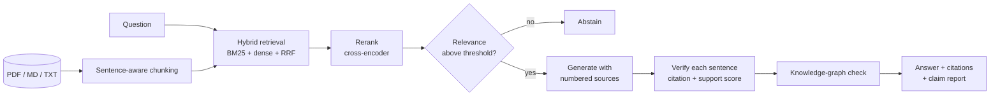

# MedTrace

**Citation-grounded medical RAG that refuses to answer when the evidence is weak.**

MedTrace answers questions about breast cancer using only the documents you give it. Every sentence carries a citation, every citation is checked against the source text and a knowledge graph, and when the evidence isn't there, it says so instead of guessing.

> For research and education. Not medical advice.

[**Live demo**](https://medtrace-faisal.streamlit.app/) · [Eval results](#results)

---

## The problem

In healthcare, a confident wrong answer is worse than no answer. Plain RAG still hallucinates: the model blends retrieved text with its own memory, cites sources that don't say what it claims, and answers questions the documents never covered.

## What MedTrace does differently

| Failure mode | MedTrace's guard |
| --- | --- |
| Retrieval misses the right passage | Hybrid search: BM25 keywords + dense embeddings, fused with Reciprocal Rank Fusion, optional cross-encoder reranking |
| Question is outside the documents | Abstains when the best match is below a relevance threshold |
| Model adds facts from memory | Every sentence must cite `[n]`; sentences whose words aren't in the cited chunk are flagged and dropped in strict mode |
| Model cites the wrong source | Out-of-range and uncited markers are rejected |
| Claim contradicts known medical facts | Each sentence is checked against a knowledge graph of (subject, relation, object) triples |

## Architecture



## Results

Baseline run: offline extractive generator + hashing embeddings, on the 16-question demo set (12 answerable, 4 off-topic). Reproduce with `make eval`.

| Metric | Baseline |
| --- | --- |
| Retrieval hit rate | 100% |
| Answer coverage (contains expected facts) | 100% |
| Citation precision | 90.3% |
| Correct abstention on off-topic questions | 100% |
| False abstention on answerable questions | 0% |
| p50 latency | <1 ms |

The demo set is small and written alongside the sample documents, so these numbers show the pipeline works; they aren't a benchmark. The next milestone is a 100-question set over real guideline documents, comparing plain RAG, hybrid RAG and GraphRAG with Claude as the generator.

## Quick start

```bash
git clone https://github.com/<your-handle>/medtrace && cd medtrace
python -m venv .venv && source .venv/bin/activate
pip install -e ".[api,ui,dev]"
cp .env.example .env

python -m medtrace.cli ingest data/sample
python -m medtrace.cli ask "How is HER2 status tested?"
make test      # unit + pipeline tests, including hallucination checks
make eval      # metrics in eval/results.json
make api       # http://localhost:8000/docs
make ui        # Streamlit demo
```

With Docker: `cp .env.example .env && docker compose up --build`

### Deploy the demo (free)

On [Streamlit Community Cloud](https://share.streamlit.io): **Create app** → this repo, branch `main`, main file `ui/app.py`. It installs `ui/requirements.txt` and builds the index on first load. Pushes to `main` redeploy automatically.

A Hugging Face Space deploy is also included (`deploy/`, needs a PRO plan): set the repo variable `HF_DEPLOY=true` and the secret `HF_TOKEN`.

### Use real models

In `.env`:

```bash
MEDTRACE_GENERATOR=claude
ANTHROPIC_API_KEY=sk-ant-...
MEDTRACE_EMBEDDER=BAAI/bge-small-en-v1.5
MEDTRACE_RERANKER=cross-encoder/ms-marco-MiniLM-L-6-v2
```

Re-run `ingest` after changing the embedder.

## API

```bash
curl -X POST localhost:8000/ask -H "Content-Type: application/json" \
  -d '{"question": "What is neoadjuvant chemotherapy?"}'
```

The response includes the answer, citations (source, page, snippet), a per-sentence claim report (support score, knowledge-graph status), the share of unsupported sentences in the draft, and the retrieved chunks with their BM25 and dense ranks.

## Project layout

```
medtrace/
  ingest.py      sentence-aware chunking for PDF, Markdown, text
  bm25.py        dependency-free Okapi BM25
  embeddings.py  sentence-transformers or offline hashing embedder
  index.py       hybrid index with RRF fusion, save/load
  rerank.py      optional cross-encoder
  generator.py   Claude generator with citation prompt; extractive baseline
  kg.py          knowledge-graph claim checker
  pipeline.py    retrieve -> abstain -> generate -> verify -> KG check
  api.py         FastAPI service
eval/            question set + metrics runner
ui/              Streamlit demo
tests/           including scripted "hallucinating LLM" tests
```

## Roadmap

- [ ] Replace sample docs with public-domain guideline text (e.g. NCI PDQ breast cancer summaries)
- [ ] 100-question eval set; compare plain RAG vs hybrid vs GraphRAG
- [ ] Neo4j-backed knowledge graph (OncoKG: SNOMED CT, UMLS, TCGA)
- [ ] LLM-as-judge faithfulness scoring alongside the lexical support score
- [ ] Deploy API + UI (Hugging Face Spaces or Fly.io)

## About

Built by **Md Faisal Islam**, AI Engineer. This project grew out of my research on knowledge-graph-grounded clinical LLMs and uncertainty-aware models with the University of Idaho. faisalislam1610@gmail.com

MIT License.
